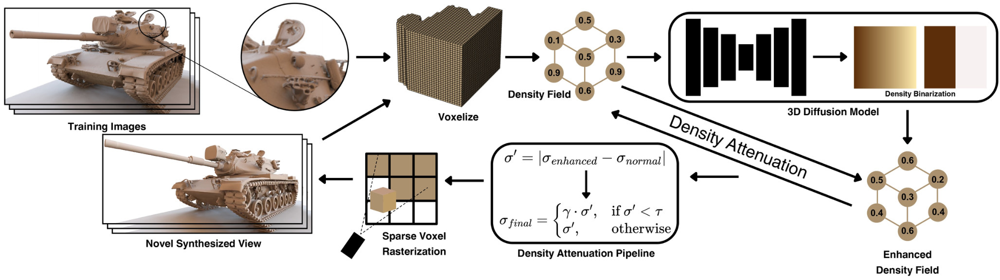
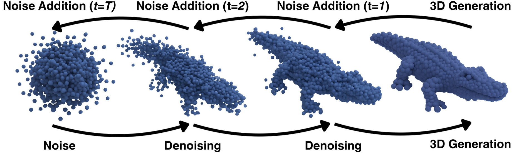
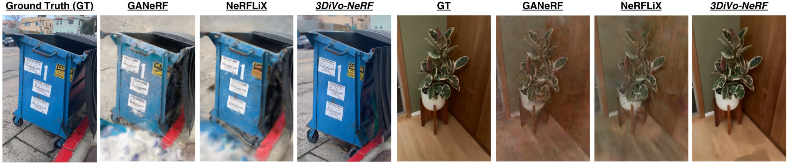
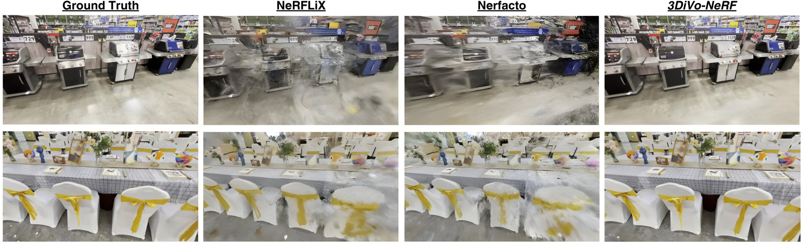
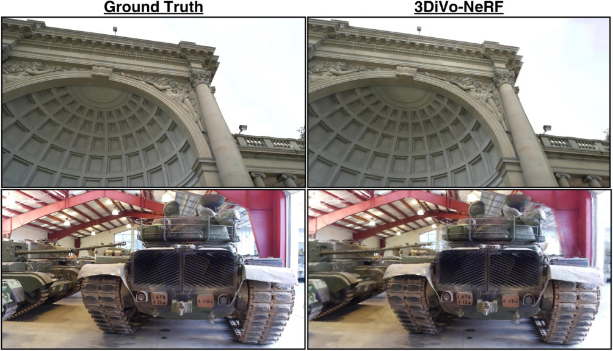

# 3DiVo-NeRF: 3D Diffusion-based Voxel Optimization for Volumetric Denoising in Neural Radiance Fields

**Darren Lau\*, Michael Tomadakis\*, Jacob Carter\*, Sanjeev Koppal**
FOCUS Lab, University of Florida · \* equal contribution



*3DiVo-NeRF takes 2D images as input and trains the [SVRaster](https://github.com/NVlabs/svraster) sparse-voxel
NeRF. Every 50 iterations, the density field is passed to the [Nerfbusters](https://github.com/ethanweber/nerfbusters)
3D diffusion model for denoising. The enhanced field is compared with the original, and voxels where the two disagree
strongly have their densities attenuated.*

## Abstract

Neural radiance fields (NeRF) have transformed novel view synthesis (NVS) by producing high-quality representations
of 3D scenes from 2D images. However, current methods still leave scenes with noisy areas and foggy artifacts, often
because of complex textures, limited data, or noisy captures. We propose **3DiVo-NeRF**, a method for denoising NeRFs
by placing a 3D diffusion model inside the NeRF training loop. Noisy and diffusion-enhanced density fields are
compared, and regions with large disparities have their densities attenuated, reducing the visibility of noise in the
final rendering. Across multiple datasets, 3DiVo-NeRF achieves better rendering and denoising than previous methods on
both qualitative and quantitative metrics.

## Method

1. **NeRF backbone (SVRaster).** The scene is a sparse voxel octree with a trilinear density field per voxel and
   view-dependent color from spherical harmonics. Voxels are rasterized in a direction-dependent Morton order, then
   adaptively pruned and subdivided during training.
2. **3D diffusion prior (Nerfbusters).** A 7.2M-parameter 3D U-Net DDPM, trained on 32³ occupancy cubes cut from
   ShapeNet meshes, predicts whether local space should be empty or occupied. Cubes are chosen by importance sampling
   from an EMA density grid.
3. **Integrated training.** After warm-up, every 50 iterations we sample 16 cubes from the current density field
   *D₁*, denoise them with the diffusion model to get an enhanced field *D₂*, and compute the per-voxel difference
   Δ(i) = |D₁(i) − D₂(i)|.
4. **Density attenuation.** Voxels where Δ(i) > τ are softly suppressed, D̃₁(i) = γ · D₁(i) with γ ∈ [0, 1]. This
   prunes floaters and fog adaptively, without a fixed opacity threshold.

The training objective combines SVRaster's photometric and regularization losses with the Nerfbusters
density-score-distillation (DSDS) and visibility losses.



## Results

Trained for 40K iterations (diffusion enabled for the last 20K) on a single NVIDIA A6000.

**Nerfbusters dataset**

| Method | PSNR ↑ | SSIM ↑ | LPIPS ↓ |
|---|---|---|---|
| Nerfbusters | 17.72 | 0.6467 | 0.3521 |
| GANeRF | 17.42 | 0.6113 | 0.3539 |
| NeRFLiX | 17.91 | 0.6560 | 0.3458 |
| Nerfacto | 17.29 | 0.6214 | 0.4021 |
| DIFIX3D (Nerfacto) | 18.08 | 0.6533 | 0.3277 |
| DIFIX3D+ (Nerfacto) | 18.32 | 0.6623 | 0.2789 |
| 3DGS | 17.66 | 0.6780 | 0.3265 |
| DIFIX3D+ (3DGS) | 18.51 | 0.6858 | 0.2637 |
| **3DiVo-NeRF** | **27.82** | **0.8732** | **0.2052** |

**DL3DV-10K dataset**

| Method | PSNR ↑ | SSIM ↑ | LPIPS ↓ |
|---|---|---|---|
| Nerfbusters | 17.45 | 0.6057 | 0.3702 |
| GANeRF | 17.54 | 0.6099 | 0.3420 |
| NeRFLiX | 17.56 | 0.6104 | 0.3588 |
| Nerfacto | 17.16 | 0.5805 | 0.4303 |
| DIFIX3D (Nerfacto) | 17.80 | 0.5964 | 0.3271 |
| DIFIX3D+ (Nerfacto) | 17.82 | 0.6127 | 0.2828 |
| 3DGS | 17.18 | 0.5877 | 0.3835 |
| DIFIX3D+ (3DGS) | 17.99 | 0.6015 | 0.2932 |
| **3DiVo-NeRF** | **26.60** | **0.9242** | **0.1957** |

**Qualitative comparison: Nerfbusters dataset**



**Qualitative comparison: DL3DV-10K**



**3DiVo-NeRF vs. ground truth: Tanks and Temples**



## Usage

This code builds on SVRaster. Follow the [SVRaster install instructions](https://github.com/NVlabs/svraster#installation)
to build the CUDA rasterizer, then install the requirements:

```bash
pip install -r requirements.txt
pip install dotmap
```

The diffusion prior comes from [Nerfbusters](https://github.com/ethanweber/nerfbusters). Clone it and download its
pretrained cube-diffusion weights (`nerfbusters-diffusion-cube-weights.ckpt`). Then point `train.py` at your copy: the
`sys.path.append(...)` near the top, plus `diff_config_path` and `diff_ckpt_path`.

Scenes must be processed with COLMAP using a pinhole camera model. The datasets are not included in this repository.

```bash
python train.py --eval --source_path data/SCENE --model_path results/SCENE \
    --lambda_T_inside 0.01 --lambda_normal_dmean 0.001 --lambda_normal_dmed 0.001 --lambda_ascending 0.01
```

Rendering, evaluation and mesh extraction use the SVRaster scripts unchanged (`render.py`, `eval.py`,
`extract_mesh.py`).

## Acknowledgments

We thank our principal investigator, Dr. Sanjeev Koppal, and the members of the Florida Optics and Computational
Sensor (FOCUS) Lab, as well as the University of Florida's Student Science Training Program (SSTP).

This repository is a fork of [SVRaster](https://github.com/NVlabs/svraster) by Cheng Sun et al. (NVIDIA) and uses
the diffusion model from [Nerfbusters](https://github.com/ethanweber/nerfbusters) by Warburg et al. The SVRaster code
remains under its original license; see [LICENSE](LICENSE) and [LICENSE_inria.md](LICENSE_inria.md).

## Citation

```bibtex
@misc{lau2025divonerf,
  title  = {3DiVo-NeRF: 3D Diffusion-based Voxel Optimization for Volumetric Denoising in Neural Radiance Fields},
  author = {Lau, Darren and Tomadakis, Michael and Carter, Jacob and Koppal, Sanjeev},
  year   = {2025},
  note   = {FOCUS Lab, University of Florida}
}
```

Please also cite the works this builds on:

```bibtex
@article{sun2024svraster,
  title   = {Sparse Voxels Rasterization: Real-time High-fidelity Radiance Field Rendering},
  author  = {Sun, Cheng and Choe, Jaesung and Loop, Charles and Ma, Wei-Chiu and Wang, Yu-Chiang Frank},
  journal = {arXiv preprint arXiv:2412.04459},
  year    = {2024}
}

@inproceedings{warburg2023nerfbusters,
  title     = {Nerfbusters: Removing Ghostly Artifacts from Casually Captured NeRFs},
  author    = {Warburg, Frederik and Weber, Ethan and Tancik, Matthew and Holynski, Aleksander and Kanazawa, Angjoo},
  booktitle = {ICCV},
  year      = {2023}
}
```
